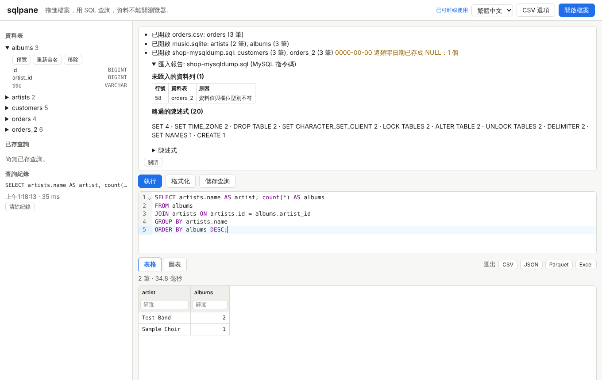
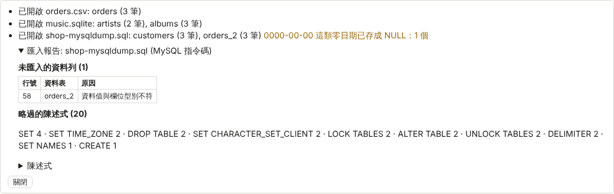
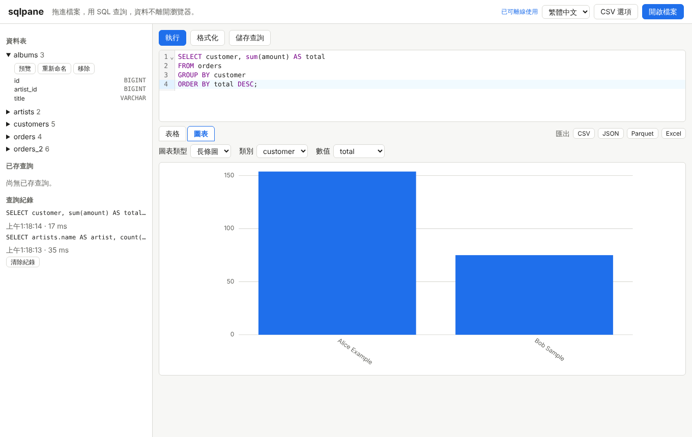
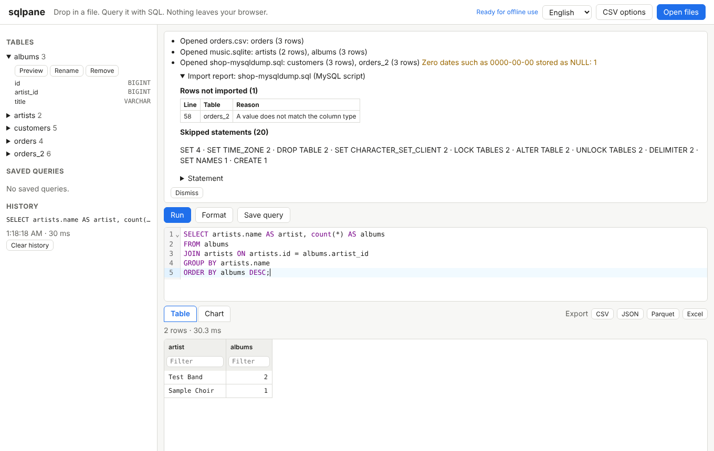
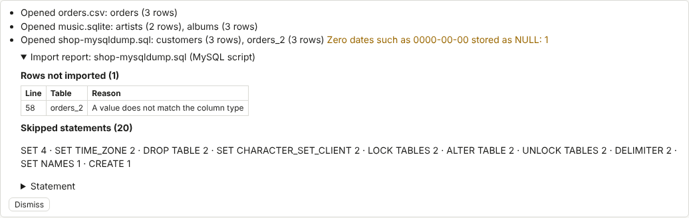
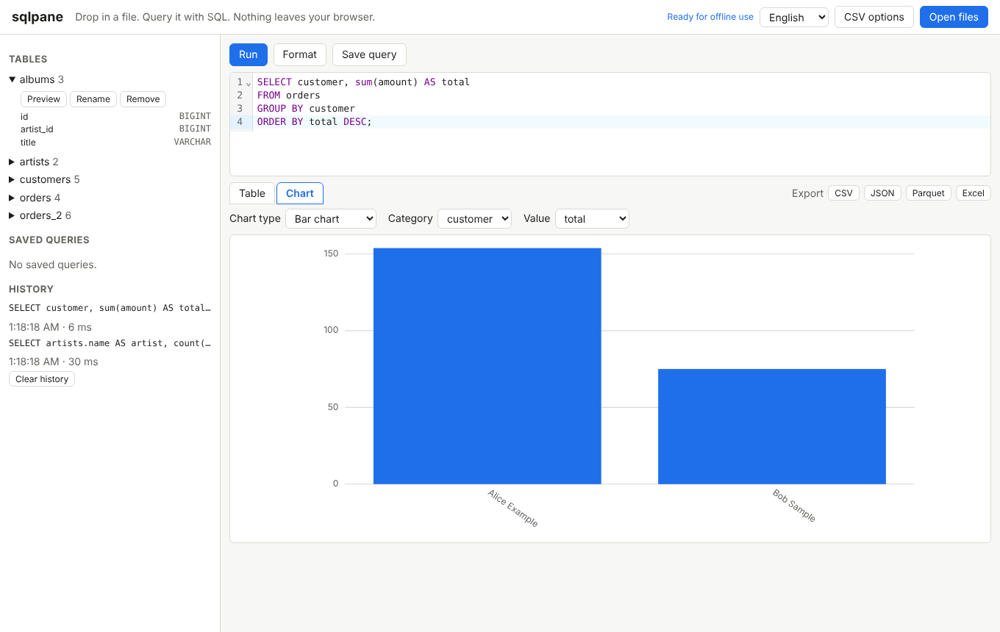

# sqlpane

**Drop in a file. Query it with SQL. Nothing leaves your browser.**

sqlpane is an offline-first SQL workbench that runs entirely in the browser. Drag in CSV, JSON, Excel, Parquet or SQLite files, or a MySQL or SQL Server script export, and query them with SQL. It is built on DuckDB-WASM and works without a server or an account.

**線上試用 / Try it online: <https://zzoraemon043.github.io/sqlpane/>**

[繁體中文](#繁體中文) | [English](#english)

---

## 繁體中文

**拖進檔案，用 SQL 查詢，資料不離開瀏覽器。**

sqlpane 是完全在瀏覽器中執行、離線優先的 SQL 工作台。把 CSV、JSON、Excel、Parquet、SQLite 檔案，或 MySQL、SQL Server 匯出的 `.sql` 指令碼拖進來，就能直接用 SQL 查詢。底層使用 DuckDB-WASM，不需要伺服器，也不需要帳號。



### 為什麼需要它

想看一個資料檔的內容，通常得先安裝資料庫、寫匯入腳本，或把檔案上傳到雲端服務。sqlpane 在瀏覽器分頁中直接打開檔案、轉成資料表，馬上就能查詢，資料始終留在你的電腦上。

### 功能

- 拖放或按「開啟檔案」開啟 CSV、TSV、JSON、NDJSON、Parquet、Excel（`.xlsx`）與 SQLite 資料庫檔
- 匯入 MySQL（`mysqldump`）與 SQL Server（產生指令碼）匯出的 `.sql` 檔，並產生匯入報告
- SQL 編輯器：語法上色、依目前結構自動補全資料表與欄位、格式化、執行游標所在或選取的陳述式
- 查詢紀錄與已存查詢保存在瀏覽器的 IndexedDB
- 結構側欄：資料表、欄位、型別與前 100 筆預覽
- 虛擬捲動的結果表格，百萬筆資料也流暢，可排序、篩選、調整欄寬，並顯示筆數與查詢時間
- 長條圖、折線圖、散佈圖、圓餅圖
- 結果匯出為 CSV、JSON、Parquet 與 Excel
- 可安裝為 PWA，第一次載入後完全離線使用
- 繁體中文與英文介面，預設依瀏覽器語言

### 使用說明

#### 開啟檔案

把檔案拖到頁面任何位置，或按右上角「開啟檔案」，可以一次選多個檔案。每個檔案會變成資料表：

| 檔案 | 資料表名稱 |
| --- | --- |
| CSV、TSV、JSON、NDJSON、Parquet | 檔名（不含副檔名），例如 `sales.csv` 變成 `sales` |
| Excel `.xlsx` | 每個工作表一張表，名稱為 `檔名_工作表名稱`，第一列當作欄位名稱 |
| SQLite `.db`、`.sqlite`、`.sqlite3` | 沿用資料庫中的資料表名稱 |
| `.sql` 指令碼 | 沿用指令碼中 `CREATE TABLE` 的資料表名稱 |

名稱已存在時會自動加上 `_2`、`_3`。在左側「資料表」展開資料表，可以「預覽」、「重新命名」或「移除」。

CSV 與 TSV 會自動偵測分隔符號、標題列與欄位型別。偵測不正確時，按「CSV 選項」指定分隔符號或是否有標題列，再重新開啟檔案。

#### 匯入 MySQL 與 SQL Server 指令碼

- MySQL：`mysqldump --databases 資料庫名稱 > dump.sql`
- SQL Server：在 SQL Server Management Studio 對資料庫按右鍵，選「工作 > 產生指令碼」，在「進階」把「要編寫指令碼的資料類型」設為「結構描述和資料」。UTF-16（Unicode）與 UTF-8 檔案都能讀取。

匯入器會處理 `CREATE TABLE`（欄位、型別、可否為 NULL、主索引鍵）、單列與多列 `INSERT`、反引號與方括號識別字、`N'...'` 字串、十六進位與位元常值、`NULL`、`CAST(... AS ...)`，以及 `GO` 批次分隔。型別會對應到 DuckDB，例如 `TINYINT(1)` 對應 `BOOLEAN`、`NVARCHAR(MAX)` 對應 `VARCHAR`、`UNIQUEIDENTIFIER` 對應 `UUID`、`MONEY` 對應 `DECIMAL(19,4)`。

`SET`、`USE`、`LOCK TABLES`、`DROP TABLE`、`ALTER TABLE`、`GO`、註解這類不影響資料的陳述式會略過。檔案以串流方式讀取，匯入時會顯示進度；完成後的匯入報告會列出略過的陳述式、無法匯入的陳述式，以及失敗資料列的行號與原因。



SQL Server 的 `.bak` 備份檔與 MySQL 的資料目錄無法直接開啟，請依上面的方式改匯出 `.sql` 指令碼。

#### 撰寫與執行查詢

| 操作 | 方式 |
| --- | --- |
| 執行游標所在的陳述式 | `Ctrl+Enter`（macOS 為 `Cmd+Enter`）或按「執行」 |
| 只執行選取的文字 | 先選取，再按 `Ctrl+Enter` |
| 自動補全資料表與欄位 | 直接輸入，或按 `Ctrl+Space` |
| 格式化 | 按「格式化」或 `Shift+Alt+F`，有選取時只格式化選取範圍 |
| 儲存查詢 | 按「儲存查詢」並輸入名稱，左側「已存查詢」可再次開啟 |

每次執行都會記在「查詢紀錄」，點一下即可帶回編輯器。瀏覽器不允許使用 IndexedDB 時（例如部分無痕模式），程式仍可正常使用，只是紀錄在關閉頁面後就會消失。

#### 結果、圖表與匯出

- 點欄位名稱依該欄排序（遞增、遞減、取消）；欄位名稱下方的輸入框可篩選，輸入 `null` 只顯示空值
- 拖曳欄位名稱右側邊界可調整欄寬
- 「圖表」分頁可選擇圖表類型、類別或 X 軸欄位與數值欄位
- 「匯出」會匯出目前篩選與排序後的資料列，Excel 最多 1,048,575 列



#### 離線使用與安裝

第一次開啟網站後，右上角顯示「已可離線使用」時，網站與 SQL 引擎都已存在瀏覽器中，之後即使沒有網路也能開啟與查詢。在 Chrome 或 Edge 中可從網址列的安裝按鈕把 sqlpane 安裝成應用程式。

### 隱私

- 所有檔案都在你的瀏覽器中讀取與查詢，不會上傳
- DuckDB 的 WebAssembly 檔、SQLite 讀取程式與其他程式碼都由網站本身提供，執行時不會從 CDN 載入任何東西
- 網站設定了 Content Security Policy，只允許連線到網站本身；DuckDB 自動下載擴充套件的功能已關閉

### 目前的限制

- 開啟的檔案會載入到瀏覽器記憶體，實際可處理的大小取決於裝置記憶體與瀏覽器限制
- Excel 只支援 `.xlsx`，不支援舊版 `.xls`
- 無法直接連線到 MySQL 或 SQL Server 伺服器
- 查詢中無法直接用 `read_parquet`、`read_json` 讀取檔案，請先開啟檔案再查詢資料表

### 開發

需要 Node.js 22。

```sh
npm ci
npm run dev          # 開發伺服器
npm test             # 單元測試
npm run lint         # 程式碼檢查
npm run build        # 建置到 dist/
npm run test:e2e     # 端對端測試（需先建置）
npm run screenshots  # 重新產生 README 截圖
```

測試資料都是手寫或由測試程式產生，不含真實個人資料。推送到 `main` 後，GitHub Actions 會建置並部署到 GitHub Pages。使用的第三方套件與授權列在 [THIRD_PARTY_NOTICES.md](THIRD_PARTY_NOTICES.md)。

### 授權

[MIT](LICENSE)

---

## English

**Drop in a file. Query it with SQL. Nothing leaves your browser.**



### Why

Looking inside a data file usually means installing a database, writing an import script or uploading the file to a cloud service. sqlpane opens the file in a browser tab, turns it into a table and lets you query it right away. Your data stays on your machine.

### Features

- Open CSV, TSV, JSON, NDJSON, Parquet, Excel (`.xlsx`) and SQLite database files by drag and drop or with Open files
- Import MySQL (`mysqldump`) and SQL Server (Generate Scripts) `.sql` exports, with an import report
- SQL editor with syntax highlighting, table and column completion from the current schema, formatting, and running the statement under the cursor or the selection
- Query history and saved queries stored in the browser's IndexedDB
- Schema sidebar with tables, columns, types and a preview of the first 100 rows
- Virtualized result grid that stays fast with millions of rows, with sorting, filtering, column resizing, row count and query time
- Bar, line, scatter and pie charts
- Export results to CSV, JSON, Parquet and Excel
- Installable as a PWA and fully usable offline after the first visit
- Interface in Traditional Chinese and English, following the browser language by default

### How to use

#### Opening files

Drop files anywhere on the page or use Open files in the top right corner. You can open several files at once. Each file becomes tables:

| File | Table name |
| --- | --- |
| CSV, TSV, JSON, NDJSON, Parquet | The file name without its extension, so `sales.csv` becomes `sales` |
| Excel `.xlsx` | One table per sheet named `file_sheet`, using the first row as column names |
| SQLite `.db`, `.sqlite`, `.sqlite3` | The table names inside the database |
| `.sql` script | The table names from the script's `CREATE TABLE` statements |

When a name is taken, `_2`, `_3` and so on is added. Expand a table under Tables to preview, rename or remove it.

CSV and TSV files are read with automatic detection of the delimiter, header row and column types. If the detection is wrong, set the delimiter or header row under CSV options and open the file again.

#### Importing MySQL and SQL Server scripts

- MySQL: `mysqldump --databases your_database > dump.sql`
- SQL Server: in SQL Server Management Studio, right-click the database, choose Tasks > Generate Scripts, and under Advanced set "Types of data to script" to "Schema and data". Both UTF-16 (Unicode) and UTF-8 files work.

The importer handles `CREATE TABLE` (columns, types, nullability and primary keys), single-row and multi-row `INSERT`, backtick and square bracket identifiers, `N'...'` strings, hex and bit literals, `NULL`, `CAST(... AS ...)` and `GO` batch separators. Types are mapped to DuckDB, for example `TINYINT(1)` to `BOOLEAN`, `NVARCHAR(MAX)` to `VARCHAR`, `UNIQUEIDENTIFIER` to `UUID` and `MONEY` to `DECIMAL(19,4)`.

Statements that do not affect data, such as `SET`, `USE`, `LOCK TABLES`, `DROP TABLE`, `ALTER TABLE`, `GO` and comments, are skipped. The file is read as a stream and the import shows its progress. The import report lists skipped statements, statements that could not be imported, and the line number and reason for every failed row.



SQL Server `.bak` backups and MySQL data directories cannot be opened. Export a `.sql` script as described above instead.

#### Writing and running queries

| Action | How |
| --- | --- |
| Run the statement under the cursor | `Ctrl+Enter` (`Cmd+Enter` on macOS) or Run |
| Run only the selection | Select text, then press `Ctrl+Enter` |
| Complete table and column names | Type, or press `Ctrl+Space` |
| Format | Format or `Shift+Alt+F`; with a selection only the selection is formatted |
| Save a query | Save query, then enter a name; open it again from Saved queries |

Every run is added to History, and clicking an entry puts it back in the editor. When the browser does not allow IndexedDB, for example in some private windows, the app keeps working and the history lasts until the page is closed.

#### Results, charts and export

- Click a column name to sort by it (ascending, descending, off). Type in the box under a column name to filter; type `null` to show only empty values
- Drag the right edge of a column header to resize the column
- The Chart tab lets you pick the chart type, the category or X axis column and the value column
- Export saves the rows currently shown after filtering and sorting. Excel holds at most 1,048,575 rows



#### Offline use and installation

After the first visit, once the header shows "Ready for offline use", the site and the SQL engine are stored in the browser and work without a network connection. In Chrome or Edge you can install sqlpane as an app from the install button in the address bar.

### Privacy

- Files are read and queried in your browser and are never uploaded
- The DuckDB WebAssembly files, the SQLite reader and all other code are served by the site itself. Nothing is loaded from a CDN at runtime
- The site sets a Content Security Policy that only allows connections to the site itself, and DuckDB's automatic extension download is turned off

### Current limits

- Opened files are loaded into browser memory, so the practical size limit depends on the device and the browser
- Excel support covers `.xlsx`, not the older `.xls`
- Connecting to a live MySQL or SQL Server is not possible
- `read_parquet` and `read_json` cannot be used inside queries; open the file first and query its table

### Development

Requires Node.js 22.

```sh
npm ci
npm run dev          # development server
npm test             # unit tests
npm run lint         # lint
npm run build        # build into dist/
npm run test:e2e     # end-to-end tests (build first)
npm run screenshots  # regenerate the README screenshots
```

Test fixtures are hand-written or generated by the tests and contain no real personal data. Pushing to `main` builds the site and deploys it to GitHub Pages with GitHub Actions. Third-party packages and their licenses are listed in [THIRD_PARTY_NOTICES.md](THIRD_PARTY_NOTICES.md).

### License

[MIT](LICENSE)
